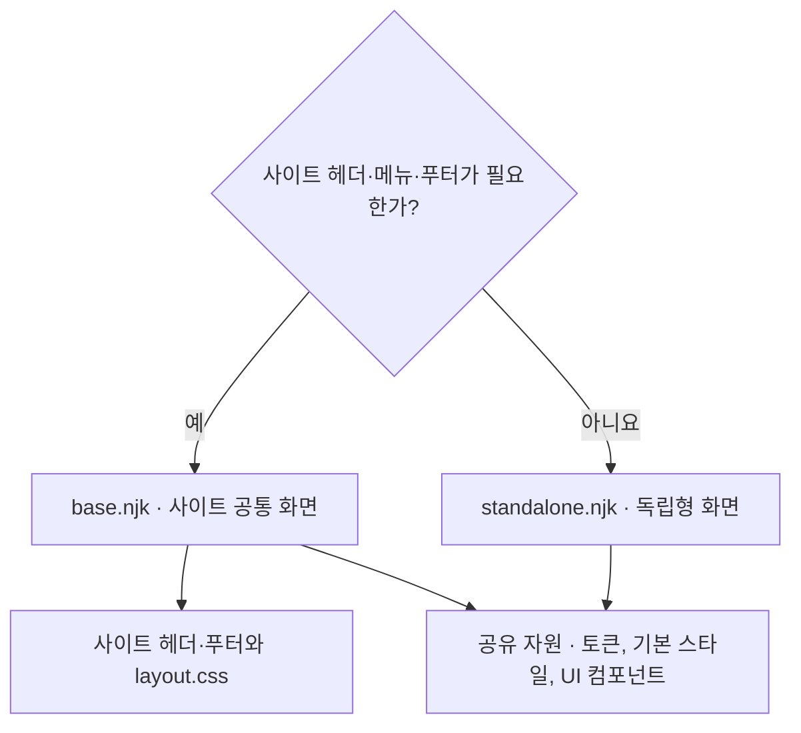

# PAGE KIT — 정적 퍼블리싱 시작 세트

Eleventy + Nunjucks로 공통 레이아웃과 include를 관리하는 독립 샘플이다. 기존 JSP·SVN 작업 사본과 연결하지 않는다. Node.js는 작업 PC에서 사용하며, 생성된 HTML을 서비스할 운영 서버에는 필요하지 않다.

## 구성 의도와 작성 기준

신규 사이트를 만들 때 **모바일 기본 배치 → 넓은 화면 확장**, **표준 HTML → 필요한 JavaScript·ARIA 보완**, **공통 토큰·컴포넌트 → 페이지 배치** 순서로 작업하기 위한 시작점이다. 모양뿐 아니라 오류·선택·처리 중·완료·실패와 키보드 초점까지 함께 참고하도록 구성했다.

퍼블리셔용 상세 기준과 파일 역할, 폰트·CSS·폼·동적 UI 작성법, 완료 전 확인 절차는 **[STYLE_GUIDE.md](STYLE_GUIDE.md)**를 먼저 읽는다. 실제 실행 결과와 미검증 항목은 [VERIFICATION.md](VERIFICATION.md)에 구분한다. 이 템플릿 자체를 접근성 인증 완료 제품으로 취급하지 않는다.

## 실행

Node.js 20 이상(지원 중인 LTS 버전 권장)이 필요하다. VS Code에서 **이 폴더 자체를 열고** 터미널에서 실행한다.

```sh
npm ci
npm run dev
```

첫 설치에서 잠금 파일이 없는 경우에는 `npm install`을 사용한다. 미리보기 주소는 터미널 출력을 기준으로 확인한다. 기본 포트는 `http://localhost:8097`이며, 포트가 사용 중이면 다른 포트로 바뀔 수 있다. Go Live를 동시에 켤 필요가 없다.

VS Code의 `터미널 → 작업 실행 → 퍼블리싱: 미리보기`로도 실행할 수 있다. 서버 종료는 해당 터미널에서 `Ctrl+C`.

## 확인할 화면

| 경로 | 예시 |
| --- | --- |
| `/` | 소개·구조 설명·공통 카드·공통 모바일 메뉴 |
| `/notice/`, `/notice/page-2/` | JSON 공지 목록·기본 details 펼침·페이지당 2건씩 생성하는 페이지네이션 |
| `/application/` | 공통 필드 매크로·레이블·도움말·로컬 형식 확인 |
| `/ui/` | 색상·버튼·카드·입력 오류·펼침·모달·폰트 다섯 굵기·탭·비동기 상태·스크롤 표 |
| `/accessibility/` | 놓치기 쉬운 대체텍스트·입력 그룹·링크/버튼·색상 외 상태·부분 언어 지정과 사용 예시 |
| `/standalone/` | 기본 사이트 헤더·푸터 없는 독립형 캠페인 페이지·동일 팝업 재사용 |

기본 레이아웃의 모바일 메뉴는 **전체 메뉴** 버튼으로 펼치고 메뉴나 버튼에서 Esc를 눌러 닫을 수 있다. JavaScript가 꺼져 있으면 메뉴 전체가 표시된다.

화면의 내용·일자는 모두 샘플이다. 신청 예시에는 서버 전송·저장·메일 발송 기능이 없으며, 실제 개인정보 대신 가상 값을 사용한다.

## 구조와 수정 위치

```text
src/
├─ _data/                      공통 사이트 정보·샘플 데이터
├─ _includes/
│  ├─ layouts/base.njk         기본 사이트 문서 골격·공통 헤더/푸터
│  ├─ layouts/standalone.njk   독립형 문서 골격·사이트 헤더/푸터 제외
│  ├─ partials/                헤더·푸터 include
│  ├─ components/macros.njk    버튼·카드·입력 필드 재사용
│  ├─ components/sample-dialog.njk  세 화면에서 공유하는 모달 팝업
│  └─ components/sample-patterns.njk  글꼴·탭·비동기·표 예시
├─ index.njk                   메인 본문
├─ notice.njk                  공지 본문
├─ application.njk             신청 본문
├─ ui.njk                      UI 견본
├─ accessibility.njk           놓치기 쉬운 접근성 사용 예시
├─ standalone.njk              독립형 페이지 본문
└─ assets/
   ├─ css/
   │  ├─ fonts.css             로컬 서브셋 웹폰트와 굵기
   │  ├─ tokens.css            값: 색·간격·글꼴·모서리
   │  ├─ base.css              전역 기본 요소
   │  ├─ layout.css            사이트 공통 골격
   │  ├─ components.css        재사용 UI
   │  ├─ utilities.css         최소 보조 클래스
   │  └─ pages/                화면별 배치
   ├─ js/main.js               폼 데모 동작
   ├─ js/navigation.js         모바일 메뉴 열기·닫기·초점 관리
   ├─ js/dialog.js             모달 열기·닫기·초점·스크롤 관리
   ├─ js/patterns.js           UI 페이지 탭·로컬 비동기 예시
   ├─ fonts/pretendard/        WOFF2 서브셋 400·500·600·700·800 및 라이선스
   └─ images/                 파비콘·정보 이미지 예시
```

페이지 앞부분의 front matter에서 `title`, `current`, `pageCss`, `permalink`를 정한다. UI 페이지처럼 전용 동작이 있으면 `pageJs`도 지정한다. `extends`는 레이아웃, `include`는 공통 영역, `macro`는 인자를 받는 UI 조각이다. `_data/site.json`의 메뉴를 바꾸면 모든 페이지에 반영된다.

## 레이아웃 선택과 레이어 팝업



- 기본 화면: ``. 사이트 헤더·메뉴·푸터와 `layout.css`를 공유한다.
- 독립형 화면: ``. 문서 골격을 별도로 사용한다. 토큰·기본 스타일·UI는 공유하지만 사이트 헤더·푸터·`layout.css`는 불러오지 않는다.
- 기본 메인은 기존 레이아웃을 유지한다. 다른 형태의 메인이 필요하면 독립형 예시처럼 별도 메인 레이아웃을 추가할 수 있다.
- 모달은 `components/sample-dialog.njk`를 include하고 `data-dialog-open="sample-dialog"` 버튼으로 연다. UI 미리보기·독립형·접근성 예시에서 같은 팝업을 사용한다.
- 다른 팝업을 만들면 dialog의 ID와 제목 ID, 버튼의 `data-dialog-open`·`aria-controls`, `aria-labelledby`를 맞춘다. 같은 문서 안의 ID는 고유해야 한다.
- 기본 `<dialog>`와 `showModal()`을 지원하는 현대 브라우저를 대상으로 한다. 제목으로 초기 초점, 내부 Tab 순환, Esc·버튼 닫기, 호출 버튼 복귀, 배경 스크롤 제한을 제공한다. 배경 클릭은 닫기로 처리하지 않는다.
- JS 전용 팝업이며 JS를 비활성화하거나 `<dialog>` 미지원인 환경의 대체 동작은 포함하지 않았다. 실제 기기·화면낭독기 검증은 별도로 필요하다.

CSS는 BEM 중심이다. 컴포넌트 내부 표현은 components, 화면별 배치는 pages에서 관리한다. 소수의 예외만 utilities를 사용한다. 간격 번호는 `4·8·12·16·24·32·48·64px`를 루트 16px 기준 rem으로 표현한 스케일이므로 `space-5`는 20px이 아니라 24px이다.

폰트는 **Pretendard v1.3.9 공식 WOFF2 서브셋**을 자체 제공한다. Regular 400·Medium 500·SemiBold 600·Bold 700·ExtraBold 800만 포함하며 각 파일은 약 261~266 KiB, 다섯 파일 합계는 약 1.28 MiB다. 실제 사용하는 굵기만 브라우저가 요청한다. `fonts.css`의 `font-display: swap`과 시스템 대체 글꼴을 사용하며, 라이선스·출처는 [폰트 폴더](src/assets/fonts/pretendard/README.md)에 포함했다. 외부 CDN·Bootstrap·Tailwind·SCSS는 포함하지 않는다.

신청 예시는 확인 버튼과 Enter가 같은 submit 흐름을 사용한다. 오류 요약과 입력창의 오류·도움말을 연결하고, 수정 후 오류 상태를 해제한다. 완료 문구는 `role="status"`로 안내한다. JS가 없으면 데모 확인 버튼은 비활성 상태이며 전송 기능은 제공하지 않는다. 실제 서비스에 옮길 때는 서버 검증·오류 응답·개인정보 처리와 정상 제출 경로를 따로 구현한다.

탭·비동기 상태는 `/ui/`에서 `patterns.js`로 동작한다. 탭은 방향키로 초점 이동 후 Enter·Space로 수동 선택한다. 비동기는 실제 통신 없이 로딩·성공·실패·재시도를 재현한다. 표는 열·행 제목 관계를 유지하고 좁은 화면에서 표 내부만 가로 스크롤한다.

## 저장 후 자동 반영

`npm run dev` 실행 상태에서 `src`의 템플릿·헤더·CSS·JS를 저장하면 변경 감지 후 화면이 자동 갱신된다. `src/assets`는 복사·감시 대상으로 등록했다. 이 샘플은 JS 이벤트 중복 연결을 피하도록 `domDiff: false`로 설정해 **전체 페이지를 새로고침**한다. 따라서 입력값·열린 details 상태는 초기화될 수 있다.

## HTML 생성과 전달

```sh
npm run build
npm run check
```

결과는 `dist/`에 생성된다. 수정은 항상 `src/`에서 한다. `dist/`를 직접 수정하면 다음 빌드에서 덮어써진다. 전달 시 템플릿 원본·package.json·package-lock.json·설정과 `dist/`를 함께 제공하고, `node_modules/`는 제외한다.

파일은 `/assets/` 등 사이트 루트 경로를 사용한다. 더블클릭한 `file://` 또는 하위 경로 배포용이 아니며, 로컬 개발 서버나 HTTP 서버의 루트에서 확인한다. JSP로 이관할 때 레이아웃은 Tiles/include로, 매크로는 tag 파일/include 등으로 옮기고 정적 경로를 서비스 context path에 맞춘다. JSP 처리·로그인·DB 연동 검증은 이 샘플의 범위가 아니다.

현재 빌드는 HTML 생성과 정적 파일 복사만 한다. JS/CSS minify·번들링·gzip은 포함하지 않는다. 필요해지면 배포 빌드 단계에 별도로 연결한다.

## 확인 범위

`npm run check`는 dist에서 자동 탐색한 모든 HTML의 템플릿 전개, h1·현재 메뉴·건너뛰기 연결·중복 ID·ARIA/label 참조·페이지 앵커·CSS 폰트 파일 참조·WOFF2 파일 식별자와 독립 레이아웃 분리를 검사한다. 전체 HTML 적합성 검사나 접근성 인증 검증을 대체하지 않는다. 실제 화면 검증 결과는 `VERIFICATION.md`를 참고한다.

## 새 Git 프로젝트로 복제하기

[GitHub 저장소](https://github.com/chondev/publishing-starter)에서 클론한 뒤 프로젝트 이름과 샘플을 교체한다. GitHub에 **Use this template** 버튼이 표시되면 그 버튼으로 새 저장소를 만들 수도 있다.

```sh
git clone https://github.com/chondev/publishing-starter.git
cd publishing-starter
```

- package.json의 name/description과 잠금 파일의 루트 패키지 이름을 동기화한다.
- src/_data/site.json의 사이트명·메뉴·URL, partials의 고정 브랜드 문구를 수정한다.
- tokens.css의 브랜드·글꼴·간격, 페이지 title/current/permalink와 샘플 데이터를 수정한다.
- npm ci → npm run build → npm run check 순서로 확인한다. 페이지 삭제 시 dist의 낡은 출력도 정리하고 재생성한다.
- 원본·설정·잠금 파일·문서는 Git에서 관리한다. node_modules/dist/.qa는 제외한다. 앞의 dist 포함 안내는 정적 산출물 외부 전달에 해당한다.
- `.github/workflows/check.yml`은 push와 PR에서 Node.js 24로 설치·빌드·검사를 수행한다. 실행 결과는 GitHub의 **Actions** 탭에서 확인한다.
